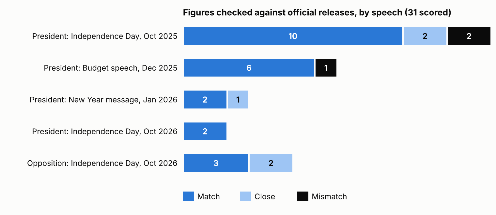

# Tally

**Do their numbers match?** An open, auditable dataset of the figures Nigerian leaders quote in national addresses, each one checked against the official release it refers to.

Apart Research AI x Epistemics Research Sprint, 13 to 15 November 2026. Track 4 (Open Track).

| | |
|---|---|
| Report | [`report/Tally-report.pdf`](report/Tally-report.pdf) |
| Dataset | [`data/claims.csv`](data/claims.csv) |
| Guide for judges | [`JUDGES.md`](JUDGES.md) |
| Second-check results | [`check/second_check.json`](check/second_check.json) |
| Checking log | [`notes.md`](notes.md) |

## Summary

Five national addresses were chosen before any checking: four by President Bola Tinubu and one by opposition candidate Atiku Abubakar. The figures in them were listed (59). 33 were checked against releases from Nigeria's statistics bureau, central bank, debt office and other official bodies, and 31 could be scored.

| Verdict | Count | Share of the 31 scored |
|---|---|---|
| Match | 23 | 74% |
| Close | 5 | 16% |
| Mismatch | 3 | 10% |

The dataset was then tested twice by means that do not depend on the first checker:

- A script with no AI in it downloaded every source and looked for the recorded official numbers on the page.
- A different AI model coded all 31 rows blind, seeing only the claim and the source text.

The blind second coder found a match rate of 71% against 74%, and gave the same verdict on 22 of 31 rows. So the headline holds under a second checker. The exact line between "close" and "mismatch" does not, and the report says so.

## Why this matters

Political speeches lean on numbers. Growth is up, inflation is down, reserves are at a record. Each number comes from an official release, so in principle anyone can check it. In practice it is slow, and for Nigeria the author found no open dataset that puts the claims and the official figures side by side.

That gap matters for AI. Tools that check claims automatically are built and tested mostly on material from a few countries with tidy statistics. To know whether they work in Nigeria, someone first has to assemble real claims, the real figures behind them, and a verdict on each. The sprint brief asks for exactly this under Track 4: pair quantitative claims with the releases they cite, flag mismatches with links, and publish an auditable dataset. Tally is a first, small version.

## What was found



**Headline figures were accurate.** Every specific quarterly growth rate and monthly inflation rate quoted in the five speeches matched the statistics bureau exactly.

**Eight figures did not match exactly.** Three mismatches and five close calls:

| Row | Claim | Official figure | Verdict | What went wrong |
|---|---|---|---|---|
| `T25-05` | Non-oil exports are 48% of exports | Crude 52.60%. Non-crude 47.40%, of which petroleum products and gas 34.21% and non-oil 13.39% | mismatch | A definition was swapped. The 48% is the non-crude share |
| `T25-07` | Oil output rose from "barely one million" barrels a day in May 2023 | 1,183,691 in May 2023. 998,602 was April | mismatch (contested) | The baseline belongs to the month before |
| `TB-06` | Over 418,000 students supported by the loan fund | 510,378 already reported in September | mismatch | Out of date |
| `TN-02` | The stock market gained 48.12% in 2025 | 51.19% for the full year | close | Out of date by ten days |
| `T25-13` | Tax-to-GDP rose "from less than 10 per cent" | 10.86% | close | Baseline understated |
| `T25-11` | Student upkeep allowance of N44.7 billion | N45.7 billion | close | Transcription |
| `A26-05` | A sliced loaf was "about N500" in April 2023 | N577.41 | close | Baseline understated |
| `A26-03` | N70,000 "buys just 50 litres" of petrol | 44 litres at the latest official price found; 48 to 50 at pump prices that month | close | Official figure for the month not found |

**The errors ran both ways.** Seven of the eight have a clear direction. Four helped the speaker's argument and three hurt it. The biggest single error, the non-oil exports definition, helped. Seven cases are too few to say anything about intent, and the report does not.

**Two claims do not fit match or mismatch.**

- The President's foreign investment figure ($720 million) matches the central bank exactly. The statistics bureau reports $296 million for the same quarter. Both are official.
- The fall in the debt service to revenue ratio "from 97% to below 50%" appears only in government statements. No published series was found.

The two speakers should not be compared from these counts. One gave four speeches and the other gave one, and different shares were checked.

## How reliable is it

| Check | Who or what did it | Result |
|---|---|---|
| Speeches re-read from scratch | First checker | 8 missed figures added. Two verdicts revised |
| Every source re-opened | First checker | All verdicts held. 8 rows had a figure or link corrected |
| Numbers on the page | Script, no AI, clean GitHub machine | A source opened for all 31 rows. Every recorded number found in 26. In the other 5 the quoted figures were found; the missing items were the checker's own arithmetic, a number written in another form, or a non-numeric figure |
| Blind second coder | Different AI model (gpt-5.4-mini through SERV Reasoning) | Same verdict on 22 of 31 (71%, Cohen's kappa 0.34). Same on match versus not on 26 of 31 (84%) |

What the second coder changed:

- One verdict moved from mismatch to close (`TN-02`), because the first checker had not applied its own 10% threshold.
- Two April 2023 prices the first checker had failed to find were located (`A26-04`, `A26-05`).
- One verdict is contested (`T25-07`). The second coder read "barely one million" as fair for 1.18 million. It stays a mismatch here and the row says it is contested.

All nine disagreements are in Appendix B of the report, each with what was done about it.

What these checks do not cover: the second coder read the sources the first checker chose, so the choice of source was not tested. No person verified the rows.

## Method

1. **Speeches fixed first.** Five scripted addresses with published full texts, October 2025 to October 2026. The opposition address was given the same morning as the President's 2026 Independence Day address, so both sides go through one procedure.
2. **Figures listed.** Each statement with a number about the economy or public money. Proposals and targets were left out.
3. **Official figure looked up.** National Bureau of Statistics, Central Bank of Nigeria, Debt Management Office, the petroleum regulator, the student loan fund, the export council.
4. **Verdict given**, with a link.

| Verdict | Meaning |
|---|---|
| match | The official figure agrees with the claim |
| close | Within rounding, or within roughly 10 to 15 per cent |
| mismatch | Materially different, or a different quantity from the one named |
| unverifiable | Only the speaker's own side repeats the figure |
| forecast | A prediction when spoken. Recorded with its outcome, not scored |
| not checked | Listed, not reached |

## Check it yourself

**In two minutes.** Open `data/claims.csv`, pick any scored row, open its `source_url`, and compare. Good rows to start with: `T25-05` (the main finding), `T25-07` (the contested one), `TN-03` (two official sources that disagree).

**Reproduce every number in the report.** Python 3, nothing to install:

```
python3 analyze.py
```

It prints the counts and the agreement figures and rewrites `data/summary.json`.

**Rerun the independent checks.** `second_check.py` downloads the sources and runs the number matching. It needs `pdfplumber`. With a `SERV_API_KEY` in the environment it also runs the blind second coder. In this repository it runs through GitHub Actions (`.github/workflows/second-check.yml`).

## What is in this repository

| Path | What it is |
|---|---|
| `data/claims.csv` | The dataset. One row per figure |
| `data/summary.json` | Every count used in the report |
| `analyze.py` | Computes the counts and the agreement figures |
| `second_check.py` | The two independent checks |
| `check/second_check.json` | Their raw output, including the second coder's reason on every row |
| `figure.py` | Draws the chart from the dataset |
| `notes.md` | The checking log, including what each pass changed |
| `report/Tally-report.pdf` | The report |
| `report/report.tex` | Report source |
| `JUDGES.md` | Where to look, claim by claim, and the weakest points |

## Dataset columns

| Column | Meaning |
|---|---|
| `id` | Speech code plus number. `U` marks an unchecked figure |
| `speaker`, `role` | Who said it |
| `speech`, `speech_date`, `speech_url` | Where it was said, with a link to the full text |
| `claim` | The figure as stated. Sometimes an excerpt of the sentence |
| `period` | The period the figure refers to |
| `official_figure` | What the official release says |
| `official_source` | Which body published it |
| `source_type` | `primary document`, `press report of official release`, `independent secondary source`, or `government statement only` |
| `source_url` | Link used for the check |
| `verdict` | One of the six verdicts above |
| `error_type` | For close and mismatch rows |
| `direction` | `favourable` if the error helps the speaker's argument, `unfavourable` if it hurts |
| `note` | Anything needed to interpret the row, including second links and changes made after the checks |

## Limits

- **Small.** Five speeches, 31 scored figures, 26 unchecked.
- **Not a random sample.** The most prominent figures were checked first. The 74% applies to the checked figures only.
- **No human checker.** Both checkers are AI models. Their agreement was only fair (kappa 0.34), mostly over where close ends and mismatch begins. Read the eight rows that did not match exactly as one group.
- **Source choice was not independently tested.** The second coder read the sources the first checker picked.
- **Mostly secondary sources.** 3 scored figures were read from the statistics bureau's own document. 26 rely on press reports quoting the official release and 2 on independent secondary sources.
- **Two verdicts rest on arithmetic, not a quoted figure.** The 44.3% rise in the trade surplus was recomputed from the report's own numbers. "Over 4 per cent" growth in 2026 uses two official quarterly rates whose average is not an official figure.
- **The list may be incomplete.** The first pass missed eight figures.
- **Official figures are the reference, not the truth.** They can be wrong or revised, and several series were rebased during the period.

This is a starting dataset, not a fact-check of record. Re-check a row before relying on it.

## How to extend it

- Have a person verify each verdict.
- Check the 26 rows marked `not checked`.
- Replace press links with the primary release where one is online.
- Add speeches and speakers using the same procedure.

## AI assistance and prior work

An AI assistant (Claude, Anthropic) did the web research, checking, analysis and drafting, under the author's direction. A second model (gpt-5.4-mini) was used only as the blind second coder. Nothing in this repository existed before the sprint.

## Author

Mia
